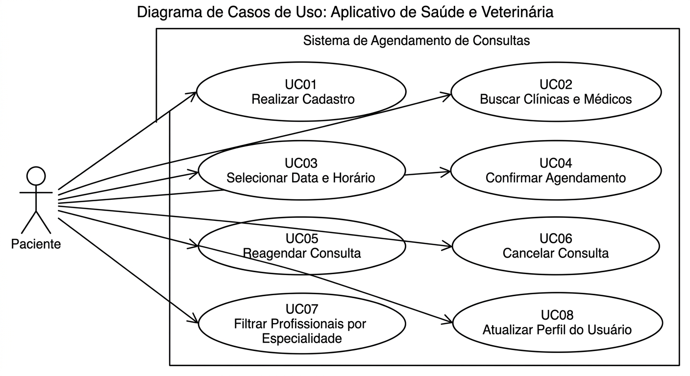

# 🏥 App Saúde & Consulta (S&C)

## 👥 Integrante
* Kauê de Souza Marinho

## 📝 Descrição do Projeto
O S&C é um aplicativo mobile desenvolvido com React Native, Expo e TypeScript. A proposta é facilitar a busca e o agendamento de consultas médicas e veterinárias.

## 🛠️ Como executar o projeto
1. Instale as dependências: `npm install`
2. Execute o projeto no Expo Go: `npx expo start`
3. Abra o aplicativo **Expo Go** no celular e leia o QR Code.
4. Link das telas do Figma: https://www.figma.com/design/Syu9uPGxsuJKyZzWRMuDRa/S-C?node-id=0-1&t=pEZoB5x5PJ6EF7eT-1

## 📌 Diagrama de Casos de Uso
* **Ator Principal:** Usuário/Paciente.
* **Casos de Uso Principais:**
* UC01 - Realizar Cadastro / Autenticação: Permite ao paciente criar uma conta no aplicativo ou fazer login com suas credenciais para acessar os serviços de saúde.

* UC02 - Buscar Clínicas e Médicos/Veterinários: Permite ao usuário explorar e localizar profissionais de saúde ou clínicas disponíveis na plataforma.

* UC03 - Selecionar Data e Horário para Consulta: Permite ao paciente navegar pelas opções de agenda e escolher o melhor dia e horário com o profissional desejado.

* UC04 - Confirmar Agendamento: Valida e consolida o pedido de marcação da consulta, registrando-o oficialmente no sistema.

* UC05 - Reagendar Consulta: Permite ao paciente alterar a data ou o horário de uma consulta que já estava marcada anteriormente.

* UC06 - Cancelar Consulta: Permite ao utilizador desistir de uma consulta agendada, removendo-a da lista e liberando o horário do médico.

* UC07 - Filtrar Profissionais por Especialidade: Facilita a busca refinando a listagem de médicos por áreas específicas (como cardiologia, pediatria ou veterinária).

* UC08 - Atualizar Perfil do Usuário: Permite ao paciente editar e manter atualizadas as suas informações pessoais e dados cadastrais no app.

